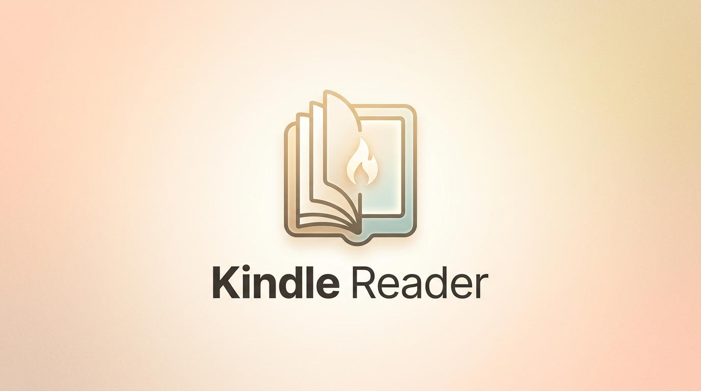
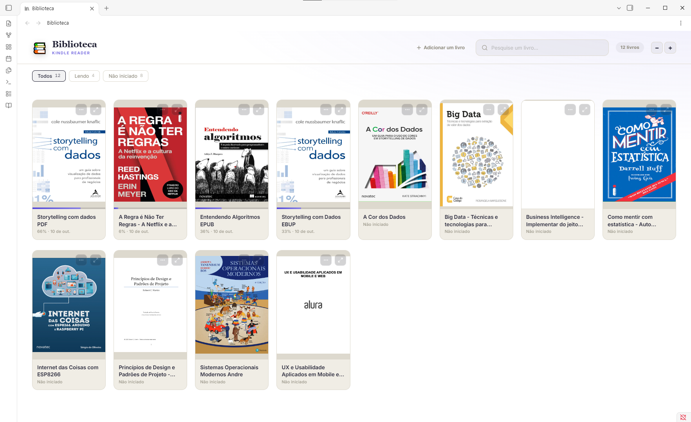
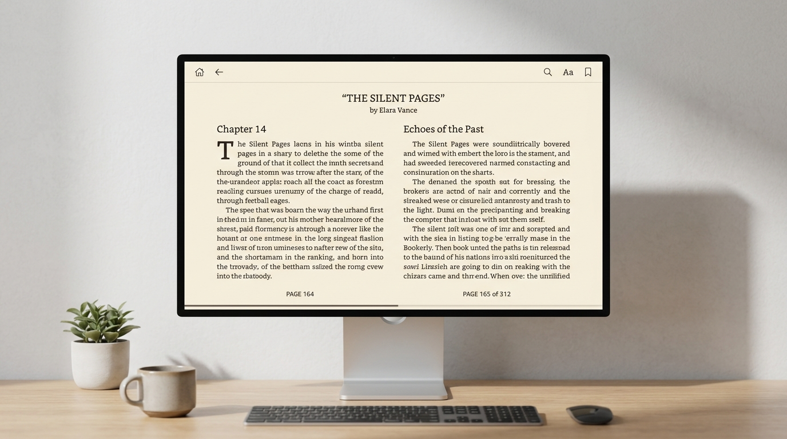
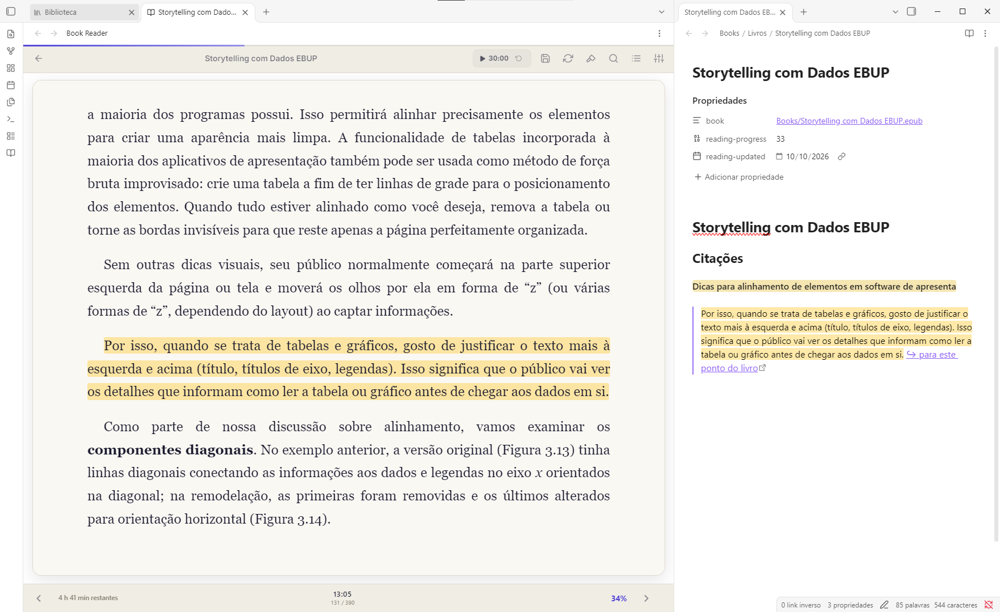
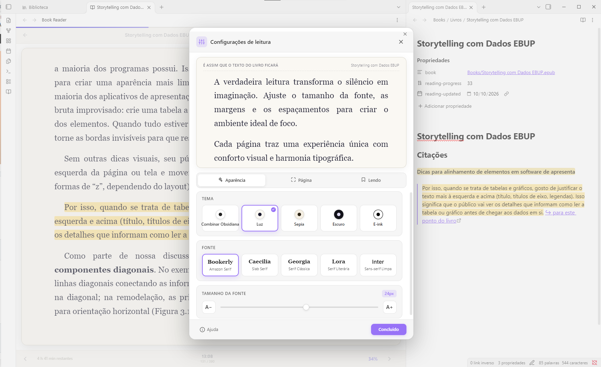
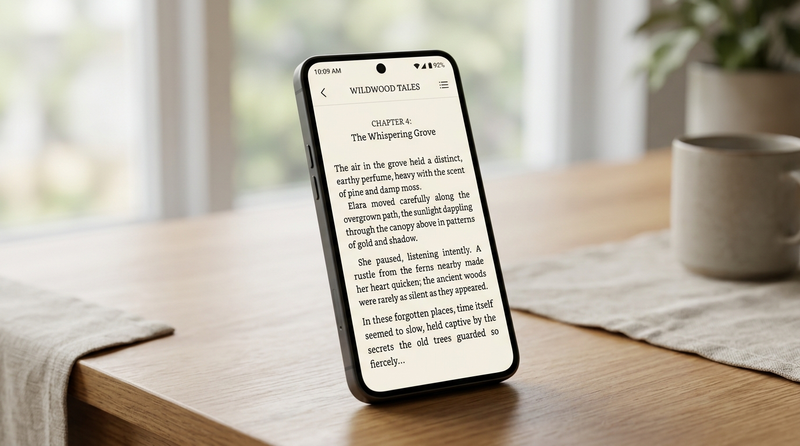
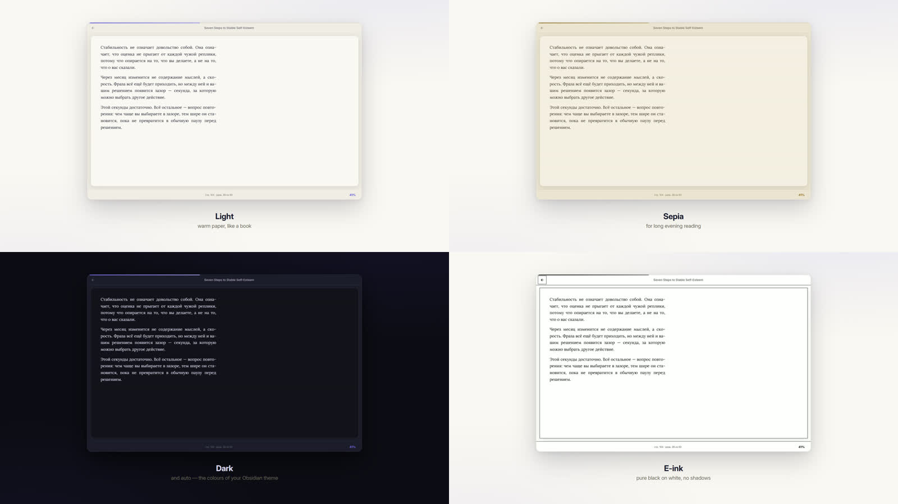

# 📖 Kindle Reader

Read EPUB, FB2 and PDF books inside Obsidian — with highlights, comments, notes
and reading progress that syncs with your vault.


**[English](#-kindle-reader) · [Português](#-kindle-reader-em-português)**

Works on desktop and on mobile (Android / iOS).

[](https://buymeacoffee.com/bernardonogueira8)



|  |  |
| --- | --- |
|  |  |
| **Library** — covers, progress and categories for every book. | **Reading** — a two-column spread, your font, size and theme. |
|  |  |
| **Highlights → notes** — four colours, a comment, and a note with the quote, the book link and the page. | **Explain a passage** — a conversation, with the book's title sent as background context. |
|  |  |
| **On the phone** — its own layout: gestures and «⋯», nothing else. Position and highlights travel with your vault. | **Four themes** — light, sepia, dark and e-ink, plus auto that follows your Obsidian theme. |

---

## What it does

**Reading.** EPUB, FB2 and PDF. Paged layout in one or two columns, like a real book. Choose from multiple stunning themes (Dark, Light, Sepia, E-ink, and Auto) and highly configurable options. Fully customize your typography (including Kindle classics Bookerly and Caecilia), size, line height, paragraph/word/letter spacing, 4 margin sizes, alignment and line width to your heart's content. Table of contents built from PDF bookmarks, headings or the book's own printed contents page. Full-text search across the whole book.

**Highlights and notes.** Four colours. A comment can be attached to any highlight and travels with it into your notes. Turn a highlight into a note, or export all of a book's highlights at once — grouped by chapter, with page numbers.

**Progress.** Stored as files in your vault next to the books, so it rides whatever you already use to sync (Obsidian Sync, iCloud, Google Drive, Remotely Save…). The position is anchored by paragraph, so a phone and a desktop find the same spot at any screen size.

**Library.** A visual grid of every book with covers, progress and categories. Add books by dragging them in.

## Support the project

If you enjoy using **Kindle Reader** and want to support its ongoing development and maintenance, consider buying me a coffee:

[](https://buymeacoffee.com/bernardonogueira8)

---

## Install

The listing is under review; until it goes live, install with BRAT or by hand.

### By hand

Download `main.js`, `manifest.json` and `styles.css` from the
[latest release](https://github.com/bernardonogueira8/kindle-reader/releases/latest)
into `<vault>/.obsidian/plugins/kindle-reader/`, then reload Obsidian.

---

## Privacy and network use

**The reader works fully offline.** Books, progress, highlights and notes never leave your device — the PDF engine is bundled into the plugin, so not even fonts or workers are fetched from the internet.

There is exactly one feature that makes a network request, and it is **off by default**:

| Feature | Service | What is sent | Default |
|---|---|---|---|
| Translate a selection | Google Translate (`translate.googleapis.com`) | Only the passage you selected | **Off** |
| AI passage breakdown | The service **you** pick — OpenRouter, OpenAI, or a local Ollama / LM Studio | Only the passage you selected | **Off** |

Both are turned on in *Settings → Translation*, and each says the same thing in its own description before you enable it. The AI breakdown additionally needs a provider and a key before it will do anything.

Choosing **Ollama or LM Studio** keeps everything on your own machine — the passage never reaches the internet at all.

The API key you enter is stored in the plugin's settings inside your vault. If your vault syncs, the key syncs with it.

No account is required for the plugin itself, and there is no telemetry, no analytics and no ads.

---
## Release History

**v2.0.1**
- Documentation cleanup and historical changelog reorganization.

**v2.0.0 (The Kindle-like Update)**
- **Premium Aesthetics:** Completely redesigned with a Kindle-inspired look, featuring the Bookerly font, light theme, and highly customizable typography (line height, margins, letter spacing).
- **Rich PDF Engine:** Major rendering fixes for PDFs. Bold, italic, and light fonts are now preserved. Fixed a critical bug where text blocks were incorrectly rasterized as blurry, cropped images.
- **EPUB Improvements:** Corrected HTML structure detection to prevent subtitles from being erroneously numbered as list items.
- **Mobile Enhancements:** Added a dedicated Table of Contents (TOC) and Close button to the mobile top bar.

**v1.0.x**
- **1.0.3:** Bundle optimization, security updates, and a new 3-column progress footer (time remaining, clock, percentage).
- **1.0.2:** Android full-screen mode and introduction of Kindle classic fonts (Bookerly, Caecilia).
- **1.0.1 - 1.0.0:** Initial robust releases featuring offline EPUB/FB2/PDF reading, built-in translation, AI passage breakdown, highlight extraction, and a visual grid library.

Full technical history: [`versions.json`](versions.json) and GitHub release notes.

---

## Building from source

```bash
npm install
npm run build      # -> main.js
npx eslint src/    # community plugin rules
```

The plugin's own code is `src/main.js`. `main.js` at the repository root is the
build output — generated by esbuild, with pdf.js, epub.js, JSZip and localForage
bundled in. `npm run build` on a clean checkout reproduces the released file
byte for byte.

---


## Licence

MIT — see [LICENSE](LICENSE).


---
# 📖 Kindle Reader em português

Leia livros EPUB, FB2 e PDF dentro do Obsidian — com destaques, comentários,
notas e progresso de leitura sincronizado com o seu vault.


**[English](#-kindle-reader) · Português**

Funciona em computadores e dispositivos móveis (Android / iOS).

[](https://buymeacoffee.com/bernardonogueira8)

> **Envie sugestões e problemas para o bot do Telegram [@book_in_obsidian_bot](https://t.me/book_in_obsidian_bot).**
> Encontrou um erro, sentiu falta de um recurso ou algo ficou estranho no celular? Envie uma
> mensagem comum. Não precisa de conta no GitHub nem de formulário. Todas as mensagens são lidas
> e ajudam a orientar as próximas versões.


|  |  |
| --- | --- |
|  |  |
| **Biblioteca** — capas, progresso e categorias para cada livro. | **Leitura** — páginas em duas colunas, com sua fonte, tamanho e tema. |
|  |  |
| **Destaques → notas** — quatro cores, comentários e notas com a citação, o link para o livro e a página. | **Múltiplas opções** — configurações de IA, tradução, pesquisa, temas, e mais. |
|  |  |
| **No celular** — um layout próprio, com gestos e «⋯». A posição e os destaques acompanham o vault. | **Mais de quatro temas** — claro, sépia, escuro e e-ink, além do automático que segue o tema do Obsidian. |

---

## Recursos

**Leitura.** EPUB, FB2 e PDF. Layout paginado em uma ou duas colunas, como um
livro de verdade. Escolha entre múltiplos temas deslumbrantes (Escuro, Claro, Sépia, E-ink e Automático) e opções de layout altamente configuráveis. Ajuste à vontade a tipografia (incluindo as clássicas do Kindle Bookerly e Caecilia), o tamanho,
espaçamentos detalhados (entre linhas, parágrafos, palavras e caracteres), 4 tamanhos de
margens, alinhamento e largura da linha. O sumário pode ser criado a partir dos marcadores
do PDF, dos títulos ou do sumário impresso do próprio livro. Pesquise o texto completo.

**Destaques e notas.** Quatro cores. Você pode adicionar comentários aos
destaques, que acompanham as citações nas notas. Transforme um destaque em nota
ou exporte todos os destaques de um livro de uma só vez, agrupados por capítulo e
com números de página.

**Progresso.** Salvo em arquivos no vault, junto aos livros, para sincronizar
com o serviço que você já usa (Obsidian Sync, iCloud, Google Drive, Remotely
Save…). A posição é vinculada ao parágrafo, então o celular e o computador
retomam a leitura no mesmo lugar, em qualquer tamanho de tela.

**Biblioteca.** Uma grade visual com capas, progresso e categorias para todos os
livros. Adicione livros arrastando os arquivos para a janela.

## Apoie o projeto

Se você gosta do **Kindle Reader** e quer apoiar o desenvolvimento contínuo de novos recursos e melhorias, considere me pagar um café:

[](https://buymeacoffee.com/bernardonogueira8)

---

## Instalação

O plugin está em análise para publicação no catálogo. Enquanto isso, instale-o
manualmente.

Baixe `main.js`, `manifest.json` e `styles.css` do
[último lançamento](https://github.com/bernardonogueira8/kindle-reader/releases/latest)
para `<vault>/.obsidian/plugins/kindle-reader/` e reinicie o Obsidian.

---

## Privacidade e uso da rede

**O leitor funciona totalmente offline.** Livros, progresso, destaques e notas
não saem do seu dispositivo — o mecanismo de PDF está incluído no plugin, que
não baixa da internet nem mesmo fontes ou workers.

Há apenas um recurso que faz uma solicitação de rede, e ele vem **desativado por
padrão**:

| Recurso | Serviço | Dados enviados | Padrão |
|---|---|---|---|
| Traduzir um trecho | Google Translate (`translate.googleapis.com`) | Somente o trecho selecionado | **Desativado** |
| Analisar trecho com IA | O serviço que **você** escolher — OpenRouter, OpenAI ou Ollama / LM Studio local | Somente o trecho selecionado | **Desativado** |

Ative esses recursos em *Configurações → Tradução*. Antes da ativação, cada um
informa isso na própria descrição. A análise com IA também exige que você escolha
um provedor e informe uma chave.

Com **Ollama ou LM Studio**, tudo permanece na sua máquina — o trecho não é
transmitido pela internet.

A chave de API fica nas configurações do plugin dentro do seu vault. Se o vault
for sincronizado, a chave também será sincronizada.

O plugin não exige uma conta e não tem telemetria, análise de uso ou anúncios.

---

## Histórico de Versões

**v2.0.1**
- Limpeza na documentação e reorganização do histórico de novidades.

**v2.0.0 (A Atualização "Kindle")**
- **Estética Premium:** Redesign completo inspirado no Kindle, com fonte Bookerly, tema claro e tipografia altamente customizável (altura de linha, margens, espaçamento de letras).
- **Motor de PDF Aprimorado:** Correções severas de renderização. O sistema agora preserva negrito, itálico e fontes finas no PDF, e corrige definitivamente o bug onde textos com fundo vetorial viravam imagens recortadas.
- **Melhorias em EPUB:** Detecção de estrutura HTML corrigida para impedir que subtítulos fossem lidos erroneamente como itens de lista enumerada.
- **Interface Mobile:** Adicionado botão de Índice (TOC) e Fechar direto na barra superior do celular.

**v1.0.x**
- **1.0.3:** Otimização do pacote, atualizações de segurança e novo rodapé de progresso triplo (tempo restante, relógio e porcentagem).
- **1.0.2:** Tela cheia automática no Android e introdução das fontes clássicas do Kindle (Bookerly, Caecilia).
- **1.0.1 - 1.0.0:** Lançamentos iniciais robustos com leitura de EPUB/FB2/PDF offline, tradução nativa, explicação avançada com IA, biblioteca visual e exportação rica de citações.

Histórico completo: [`versions.json`](versions.json) e notas dos lançamentos no GitHub.

---

## Compilar a partir do código-fonte

```bash
npm install
npm run build      # -> main.js
npx eslint src/    # regras para plugins da comunidade
```

O código do plugin fica em `src/main.js`. O `main.js` na raiz do repositório é
gerado pelo esbuild e inclui pdf.js, epub.js, JSZip e localForage. Executar
`npm run build` em uma cópia limpa reproduz o arquivo publicado byte a byte.

---


---

## Licença

MIT — consulte [LICENSE](LICENSE).
